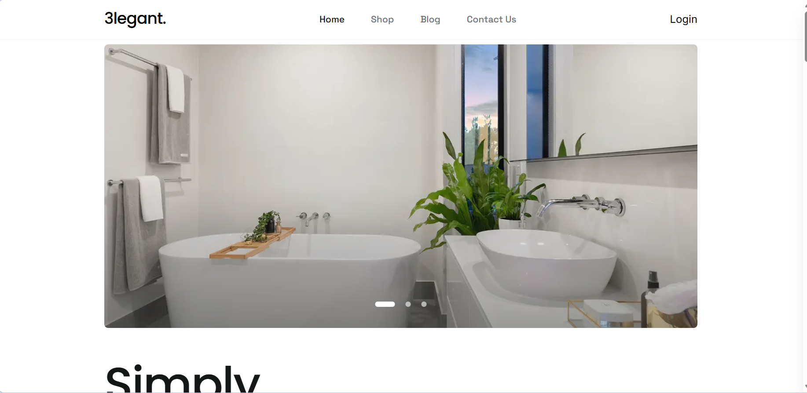

# Elegant Store

A full-stack e-commerce and editorial content platform built with Next.js (App Router), MongoDB, Stripe, and Kinde Auth. Includes a customer storefront, payment processing, and a role-protected admin dashboard for inventory, order, and blog management.

🔗 **Live Demo:** https://elegant-ecommerce-vert.vercel.app



---

## Core Architecture & Features

### Storefront & Checkout
* **Server-First Data Fetching:** Uses Next.js App Router Server Components for product catalogs, category filtering, and dynamic SEO metadata (`sitemap.ts`, `robots.ts`) to minimize client-side bundle size.
* **Payment Processing:** Integrated Stripe checkout workflow with webhook/order status tracking and cart state persistence.
* **Media Pipeline:** Automated product and editorial image uploads and optimization via Cloudinary.

### Admin Dashboard
* **Inventory Management:** Full CRUD operations for products, pricing, stock levels, and category assignments.
* **Editorial CMS:** Built-in blog publishing workflow allowing admins to draft, categorize, and publish store articles.
* **Analytics Overview:** Real-time aggregation of total revenue, order volume, and registered user metrics.

### Authentication & Security
* **Kinde Auth Integration:** Passwordless and OAuth authentication with route-level middleware protection restricting `/admin` endpoints to authorized roles.

---

## Tech Stack

* **Frontend:** Next.js (App Router), React, TypeScript, Tailwind CSS
* **Backend & Database:** Next.js Route Handlers, MongoDB, Mongoose
* **Auth, Payments & Media:** Kinde Auth, Stripe, Cloudinary
* **Deployment:** Vercel

---

## Engineering Challenges & Debugging Log

### Resolving Production Kinde Auth State Mismatches
* **Issue:** During production deployment on Vercel, authentication callbacks intermittently failed with state mismatch errors and redirect loops.
* **Root Cause:** Route protection middleware was configured to guard a non-existent route path, causing unauthenticated redirects to collide with Kinde's OAuth callback handshake and invalidating the session state cookie.
* **Fix:** Audited browser network payloads during the OAuth redirect lifecycle, removed the dead route matcher from middleware, and explicitly aligned `KINDE_SITE_URL` and callback URLs across local and Vercel environments.

---

## Local Setup

1. **Clone the repository:**
   ```bash
   git clone [https://github.com/Baptist20/elegant-ecommerce.git](https://github.com/Baptist20/elegant-ecommerce.git)
   cd elegant-ecommerce
2. **Install dependencies:**
   ```bash
   npm install
3. **Configure environment variables:**
   Create a .env.local file in the root directory and add:
   MONGODB_URI=your_mongodb_connection_string
   KINDE_CLIENT_ID=your_kinde_client_id
   KINDE_CLIENT_SECRET=your_kinde_client_secret
   KINDE_ISSUER_URL=https://your-subdomain.kinde.com
   KINDE_SITE_URL=http://localhost:3000
   KINDE_POST_LOGOUT_REDIRECT_URL=http://localhost:3000
   KINDE_POST_LOGIN_REDIRECT_URL=http://localhost:3000/dashboard
   
   NEXT_PUBLIC_CLOUDINARY_CLOUD_NAME=your_cloud_name
   CLOUDINARY_API_KEY=your_api_key
   CLOUDINARY_API_SECRET=your_api_secret
   
   STRIPE_SECRET_KEY=your_stripe_secret_key
   NEXT_PUBLIC_STRIPE_PUBLISHABLE_KEY=your_stripe_publishable_key
4. **Run development server:**
   ```bash
   npm run dev
5. **Open http://localhost:3000 in your browser.**
